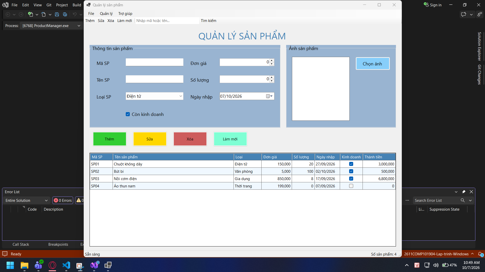
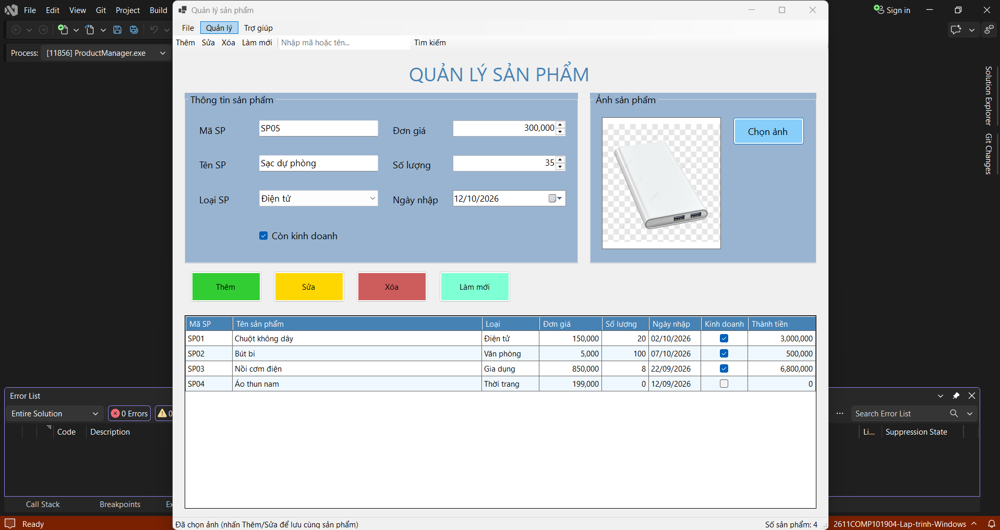
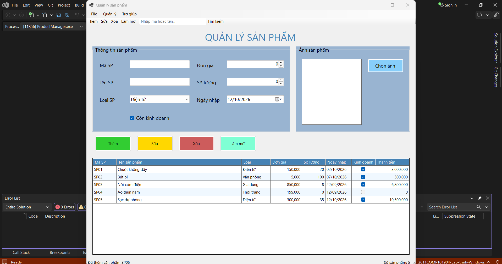
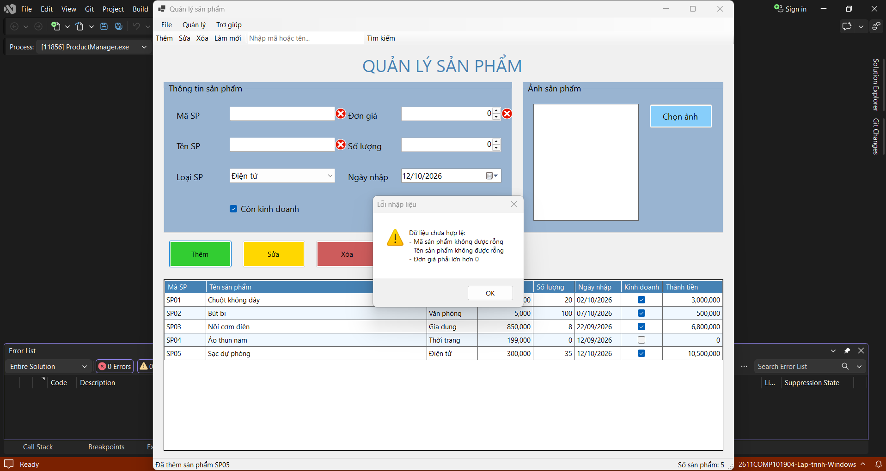
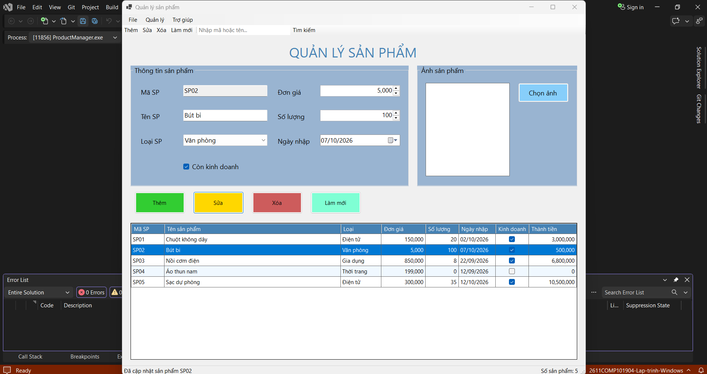
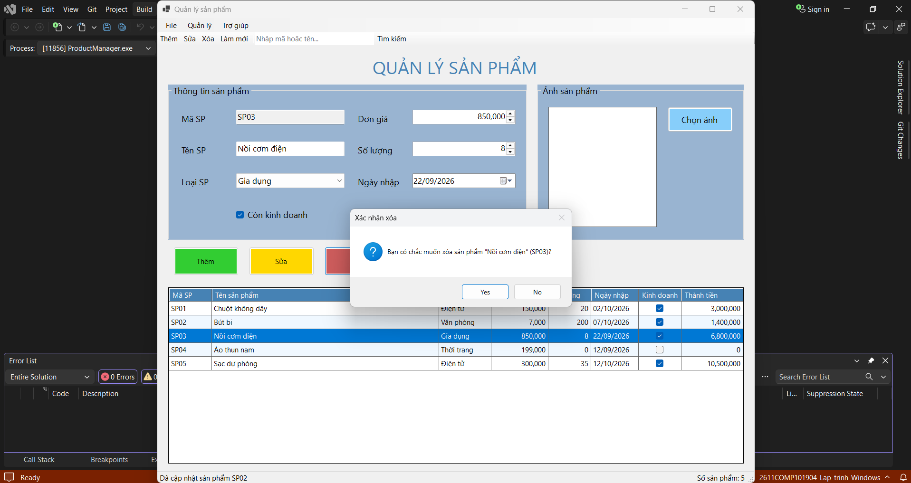
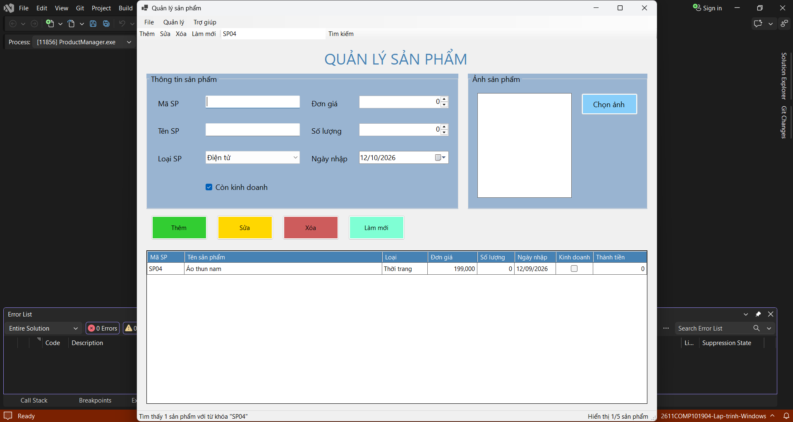
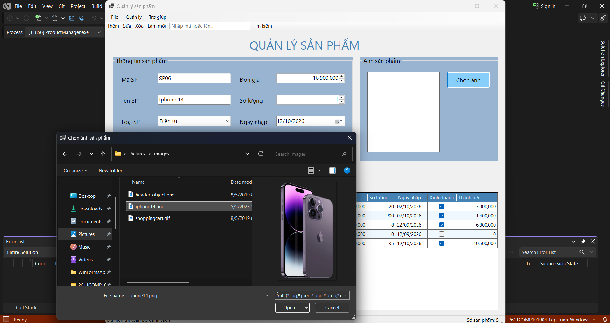

### Lab06 - Quản lý sản phẩm (ProductManager) - Windows Forms nâng cao và DataGridView

## Thông tin sinh viên
- Họ tên: Nguyễn Đan Trường
- MSSV: 51.01.104.110
- Lớp: 51.01.CNTT.A

## Mô tả
Ứng dụng Windows Forms `ProductManager` quản lý danh sách sản phẩm của một cửa hàng. Dữ liệu lưu trong bộ nhớ (`List<Product>`), hiển thị qua `BindingSource` và `DataGridView`. Form chính là `FrmProduct`, tiêu đề "Quản lý sản phẩm".

## Chức năng
- Load form: nạp danh sách loại sản phẩm, 4 sản phẩm mẫu, hiển thị lên DataGridView.
- Thêm: kiểm tra dữ liệu, mã không rỗng và không trùng (không phân biệt hoa/thường).
- Sửa: chọn dòng, dữ liệu đưa lên form, chỉnh sửa rồi nhấn Sửa (mã sản phẩm bị khóa khi sửa).
- Xóa: có MessageBox xác nhận; hỗ trợ phím Delete trên lưới.
- Tìm kiếm: theo mã hoặc tên, không phân biệt hoa/thường (nhấn Enter trong ô tìm kiếm cũng được).
- Làm mới: xóa nội dung nhập, bỏ lỗi ErrorProvider, bỏ bộ lọc, hiển thị lại toàn bộ dữ liệu.
- Chọn ảnh bằng OpenFileDialog, hiển thị trong PictureBox.
- MenuStrip (File, Quản lý, Trợ giúp) có phím tắt, ToolStrip, StatusStrip (trạng thái + số lượng sản phẩm), ContextMenuStrip (Sửa, Xóa, Xem chi tiết), double-click dòng để xem chi tiết.

## Kiểm tra lỗi logic
| Tình huống | Kết quả |
| --- | --- |
| Mã rỗng / mã trùng (kể cả "sp01" so với "SP01") | ErrorProvider + MessageBox |
| Tên rỗng | ErrorProvider + MessageBox |
| Đơn giá = 0, âm, chữ, số lẻ | ErrorProvider + MessageBox |
| Số lượng âm, chữ, số lẻ | Chặn khi gõ (chỉ nhận chữ số), kiểm tra lại khi dán chữ |
| Ngày nhập lớn hơn hôm nay | ErrorProvider + MessageBox |
| Nhấn Sửa/Xóa khi chưa chọn dòng | MessageBox nhắc chọn dòng, không lỗi |
| Chuột phải vào một dòng | Chọn đúng dòng đó rồi mới mở menu |
| Tìm kiếm rồi Sửa/Xóa | Thao tác đúng dòng đang hiển thị |

## Hình ảnh minh họa chương trình

### 1. Giao diện chính

### 2. Thêm sản phẩm

### 3. Báo lỗi nhập liệu (ErrorProvider)

### 4. Sửa sản phẩm

### 5. Xóa sản phẩm (có xác nhận)

### 6. Tìm kiếm

### 7. Menu chuột phải và chọn ảnh

